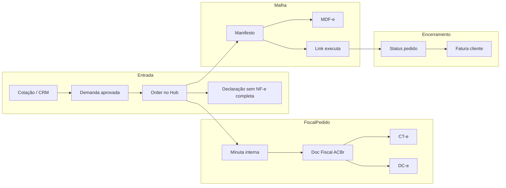

# Visão de negócio, ciclo da plataforma e ponte fiscal ACBr

## Proposta de negócio (síntese alinhada ao que você consolidou)

O TSM EX é um **orquestrador de logística e gestão**: une **hubs** (CD, coleta, entrega, recebimento, micro-hubs comissionados) e **agentes** (Links, terceiros) num ecossistema colaborativo. Cada hub pode ser operado por PJ ou PF com comissão sobre o que transita. Ao centralizar rotas e estoques, o sistema suporta **operações multi-etapas** (transferências hub a hub, consolidação, entrega final) com foco em **lucro por movimento** (complemento vs. carga fechada).

O painel administrativo (`/gestao`, ambiente [tsm.mesquitagrupo.com.br](https://tsm.mesquitagrupo.com.br/)) concentra **demandas, coletas, estoques, viagens, hubs e pessoas**, com status operacionais para a torre identificar gargalos e riscos.

**Pontos fortes do modelo** (para priorização de produto): capilaridade da rede; automação fiscal via ACBr; orquestração centralizada de estoque e rotas; base para escalar como marketplace logístico.

**Oportunidades** que o plano de implementação deve lembrar: **gatilhos** (evento → emissão/consulta de documento); **roteirização**; **consolidação e métricas por hub**; **repasses/comissões** explícitos no sistema; **UX** por papel (Hub enxuto); **auditoria** (quem emitiu/cancelou/corrigiu); integrações futuras e-commerce/ERP; **LGPD** e segregação de certificados por CNPJ/hub quando o modelo exigir.

---

## Feedback como sócio (modelo e visão)

Entendo o TSM EX como **orquestrador de uma rede logística em teia**, não como um TMS monolítico "um armazém, uma frota".

- **Hubs** são nós da rede: podem ser CD, ponto de coleta, recebimento, entrega ou até micro-hubs comissionados. Cada nó **recebe ou expede carga**, **consolida** quando faz sentido e **gera margem** (complemento de espaço vs. carga fechada, como em [docs/superpowers/specs/2026-03-31-fase1-mvp-design.md](docs/superpowers/specs/2026-03-31-fase1-mvp-design.md)).
- **Links** executam manifestos/viagens — vínculo B2B por lote, não corrida avulsa estilo app de passageiro ([CLAUDE.md](CLAUDE.md), [.cursor/plans/refatoracao-operacao-admin-hub-link.plan.md](.cursor/plans/refatoracao-operacao-admin-hub-link.plan.md)).
- **Admin** usa a mesma base de telas que o Hub (`/gestao`), com visão global e emissão fiscal; Hub vê **filtro por `hubId` + permissões**.
- **Evolução**: MVP com **históricos e ações manuais claras** ([.cursor/plans/PLANO_IMPLEMENTACAO_MVP.md](.cursor/plans/PLANO_IMPLEMENTACAO_MVP.md)) antes de autonomia total (matching, exceções automáticas).

**Em uma frase:** infraestrutura de **rede + documentação fiscal + execução**, com lucro na **densificação** de rotas e documentos.

---

## Ciclo operacional e fiscal (incluindo DC-e e "Doc Fiscal")

Fluxo de trabalho desejado:

1. **Coleta / entrada no hub** — mercadoria de cliente ou de outro hub; agrupamento por destino/serviço.
2. **Pedido — documento fiscal adequado** — conforme a natureza da entrada:
   - Com **NF-e** (ou documentação que exija conhecimento): **CT-e** (via ACBr).
   - **Sem NF-e completa**, com **declaração de conteúdo** na entrada (já prevista no fluxo de entrada): o documento fiscal de transporte/conteúdo tratado pela ACBr é a **DC-e** ([documentação DC-e](https://dev.acbr.api.br/docs/dce)).
3. **Hub** — organização, estoque, expedição para viagem ou transferência.
4. **Viagem** — **MDF-e** (ACBr) e, em **sprint dedicada após o núcleo fiscal**, **CIOT** (registro ANTEF/CIOT — fora do mesmo pacote que CT-e/MDF-e; possível **obrigatoriedade** e **risco de multas** conforme regras vigentes — validar com área fiscal/contador antes de definir escopo exato).
5. **Baixa de viagem / entrega ou entrada em outro hub** — encerramento ou reentrada em estoque para nova etapa.
6. **Hub — baixa de entrega** — conclusão ao destinatário ou hub responsável.

### Nomenclatura de produto e UX (cálculo de frete / pedido)

- Onde hoje a interface ou o discurso fala em **"Minuta e CT-e"**, evoluir para **"Minuta e Doc Fiscal"** como rótulo genérico da etapa de emissão no **cálculo de frete** / pedido.
- **Minuta** permanece documento interno operacional; **"Doc Fiscal"** é o passo que materializa na SEFAZ o documento correto: **CT-e** ou **DC-e**, conforme regra derivada do pedido (NF-e presente vs. declaração sem NF-e).
- Uma linha de cálculo que hoje é "só minuta" pode **evoluir** para **Doc Fiscal** (transição de estado: rascunho minuta → envio → autorizado/rejeitado), sem obrigar o usuário a pensar em siglas até o sistema decidir o tipo.

### Diagrama (atualizado)

**Alinhamentos com o código atual**

| Conceito | Onde está hoje |
| -------- | -------------- |
| Entrada / declaração | [components/admin/EntradaTab.tsx](components/admin/EntradaTab.tsx), fluxo NF-e em [docs/superpowers/specs/2026-03-31-fase1-mvp-design.md](docs/superpowers/specs/2026-03-31-fase1-mvp-design.md) |
| Pedido + doc transporte | `OrderFreightCalculation` com `documentType` MINUTA ou CTE; rotas em [server/src/routes/freightCalculations.ts](server/src/routes/freightCalculations.ts) — **falta ramo DC-e e flag/regra "sem NF-e + declaração"** |
| Hub | [server/prisma/schema.prisma](server/prisma/schema.prisma), permissões MVP |
| Viagem | `Manifest`; tipos `MDFE` \| `CIOT` no schema — **MDF-e ACBr a integrar**; **CIOT próxima sprint** |
| ACBr no repo | Ainda **sem** referências `acbr` no código; CT-e via **simulação** em [server/src/services/cteService.ts](server/src/services/cteService.ts) |

---

## Distribuição DF-e (prioridade explícita)

A [Distribuição DF-e na ACBr](https://dev.acbr.api.br/docs/distribuicao-nfe) (e fluxos equivalentes de distribuição na documentação ACBr) é **peça central de autonomia** na entrada: permite **baixar XML de NF-e emitidas contra o CNPJ** cadastrado, reduzindo digitação de chave e erro humano.

**No plano de implementação**, tratar DF-e em **paralelo conceitual** ao primeiro CT-e real:

- Cadastro de CNPJ + certificado na ACBr (já necessário para emissão).
- Job ou ação disparada na **entrada de pedido** / torre: "sincronizar últimas NF-e do CNPJ do hub" (NSU, continuação, armazenamento de XML e metadados).
- Ligação ao fluxo atual de **chave 44 dígitos / QR** — DF-e como **complemento**, não substituto obrigatório do primeiro dia, mas **objetivo de MVP fiscal** alinhado à sua prioridade.

---

## Integração técnica ACBr (escopos, certificados, exceções)

Recomendações já incorporadas ao plano de execução futura:

- **Tokens por escopo** (`cte`, `mdfe`, `dce`, distribuição) — renovação e falha por escopo incorreto.
- **Certificado por CNPJ** — plataforma vs. hub parceiro, conforme modelo de negócio.
- **Exceções SEFAZ** — rejeição, indisponibilidade; consulta/download de XML; persistência de chave e XML no TSM EX.
- **Sincronização de status** — demanda/pedido/manifesto refletem estado do documento (autorizado, cancelado, encerrado MDF-e).
- **Homologação + testes** automatizados por cenário (consolidada, retorno, subcontratação, etc.).

---

## CIOT: sprint seguinte (compliance)

- **Não misturar** CIOT com o pacote inicial "só ACBr REST" de CT-e / MDF-e / DC-e / DF-e.
- Tratar **CIOT na sprint imediatamente posterior** ao núcleo de viagem + MDF-e, com spike de integração (provedor/registro ANTEF) e **validação jurídica/contábil** da obrigatoriedade e penalidades (valores e abrangência dependem de norma vigente e interpretação).

---

## Playbook de subagentes (obrigatório para fases grandes)

Para tarefas extensas (ex.: **mapear todos os endpoints ACBr vs. DTOs internos**, ou implementar DF-e + CT-e + telas):

| Trilha | Escopo | Entregável típico |
| ------ | ------ | ------------------- |
| **A — Fiscal / backend** | `server/src/services`, rotas `freightCalculations`, novos `*Provider.ts`, Prisma, jobs DF-e | Contratos, integração HTTP, persistência, testes homolog |
| **B — Gestão / frontend** | `components/admin`, labels "Doc Fiscal", fluxos de entrada, estados de cálculo | UX alinhada à regra CT-e vs DC-e, feedback de rejeição |

**Regra:** paralelizar sempre que a tarefa for "mapear + implementar" em mais de ~5 arquivos cruzando API e UI.

---

## Skills no repositório

Não há skills nomeadas no workspace além de [.cursor/plans/](.cursor/plans/) e [CLAUDE.md](CLAUDE.md). Manter esses documentos como **ritual operativo** até formalizar skills no Cursor.

---

## Direção de implementação (após aprovação do plano — ordem acordada)

**Onda 1 (homologação — prioridade fixada):** **CT-e real** + **Distribuição DF-e** (entrada automática de NF-e contra CNPJ), em conjunto com **infra ACBr** (auth, escopos, certificado).

**Onda 2:** **DC-e** (regra pedido/declaração + emissão ACBr) e **modelo/UX "Doc Fiscal" completo** (status, telas de cálculo de frete/pedido, CT-e vs DC-e transparente para o operador).

**Onda 3:** **MDF-e** amarrado ao manifesto/viagem (criação, eventos, encerramento).

**Onda 4 em diante:** **CIOT** e demais compliance/integrações específicas (spike + validação jurídica).

Passos que podem antecipar a Onda 2 sem bloquear a Onda 1:

1. **Rascunho de regra** CT-e vs DC-e e labels **"Minuta e Doc Fiscal"** onde já aliviar operação (fechamento completo fica na Onda 2).
2. **Infra ACBr** — cliente HTTP, auth, env por ambiente, provedor plugável (simulação mantida para CI); na Onda 1 já habilitar escopos que a Onda 2 usará (`dce` quando for emitir DC-e).

**Governança transversal:** logs de `rawResponse`, idempotência em emissão, auditoria de quem emitiu/cancelou.

---

## Decisão de produto (registrada)

**Ordem das ondas:** **Onda 1 —** DF-e + CT-e + infra ACBr; **Onda 2 —** DC-e + modelo/UX Doc Fiscal completo; **Onda 3 —** MDF-e; **Onda 4+ —** CIOT e demais.
