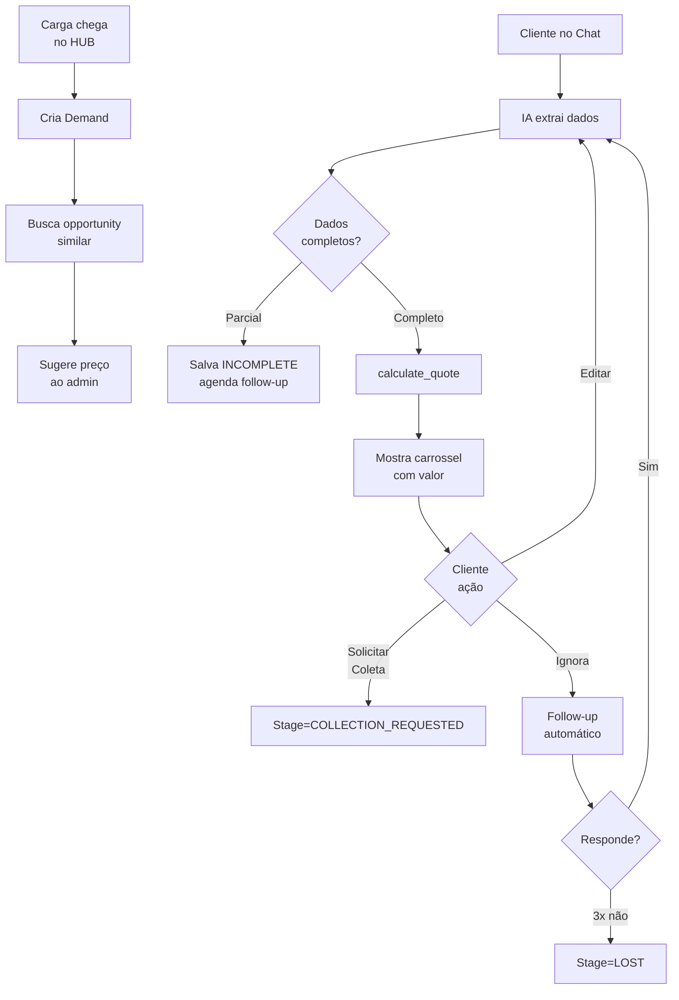

# Chat Agente - Sistema CRM com Pipeline

## 🎯 Visão Correta do Negócio

### Fluxo Real

```
Chat → Opportunity (histórico) → Cliente vê valor → Segue vida
                                                    ↓
                                    Fornecedor envia carga ao HUB
                                                    ↓
                                    Sistema cria Demand
                                                    ↓
                                    Cruzamento: "Ei, tem cotação parecida!"
                                                    ↓
                                    Agente usa valor da Opportunity
```

**Insight chave**: Opportunity ≠ Demand confirmada. É histórico de cotação para CRM e referência futura.

---

## Schema Atualizado

### 1. Account (CRM)

```prisma
model Account {
  id              String   @id @default(uuid())
  
  // Identificação
  name            String   // "Empresa ABC Ltda"
  accountType     AccountType  // COMPANY, INDIVIDUAL
  
  // Empresas/CNPJs (uma conta pode ter múltiplos)
  companies       AccountCompany[]
  
  // Contatos (pessoas físicas na conta)
  contacts        AccountContact[]
  
  // Relações
  opportunities   Opportunity[]
  demands         Demand[]
  
  // Meta
  tags            String[]  // ["cliente-gold", "urgente"]
  assignedTo      String?   // Admin responsável
  
  createdAt       DateTime @default(now())
  updatedAt       DateTime @updatedAt
}

enum AccountType {
  COMPANY      // Empresa (pode ter múltiplos CNPJs)
  INDIVIDUAL   // Pessoa física
}

model AccountCompany {
  id          String  @id @default(uuid())
  accountId   String
  account     Account @relation(fields: [accountId], references: [id], onDelete: Cascade)
  
  cnpj        String  @unique
  legalName   String  // Razão social
  tradeName   String?
  
  // Endereço padrão
  address     String?
  city        String?
  state       String?
  
  isPrimary   Boolean @default(false)
  
  createdAt   DateTime @default(now())
}

model AccountContact {
  id          String  @id @default(uuid())
  accountId   String
  account     Account @relation(fields: [accountId], references: [id], onDelete: Cascade)
  
  name        String
  role        String?  // "Gerente de Logística"
  email       String?
  phone       String?
  whatsapp    String?
  
  isPrimary   Boolean @default(false)
  
  createdAt   DateTime @default(now())
}
```

### 2. Opportunity (Histórico de Cotação)

```prisma
model Opportunity {
  id              String   @id @default(uuid())
  
  // CRM
  accountId       String
  account         Account  @relation(fields: [accountId], references: [id], onDelete: Cascade)
  
  // Conversa
  sessionId       String   // ID da sessão do chat
  source          OpportunitySource  // CHAT, WHATSAPP, MANUAL
  
  // Status
  stage           OpportunityStage
  completeness    CompletenessLevel  // COMPLETE, INCOMPLETE, MINIMAL
  
  // Tipo
  type            OpportunityType
  
  // Dados da cotação (podem estar parciais)
  cpfCnpjSender   String?
  cpfCnpjReceiver String?
  
  origin          String?   // Cidade
  destination     String?   // Cidade
  
  commodity       String?
  nfValue         Float?
  weight          Float?
  volumes         Int?
  dimensions      String?   // JSON ou string "100x50x30"
  
  // Coleta
  needsCollection Boolean   @default(false)
  collectionData  Json?     // {address, contact, time, needsHelper}
  
  // Cotação calculada
  quotedPrice     Float?
  quoteBreakdown  Json?     // {freight, gris, advalorem, icms, total}
  validUntil      DateTime? // Validade da cotação
  
  // Histórico da conversa
  conversationSnapshot Json[]
  
  // Follow-up
  lastFollowUp    DateTime?
  nextFollowUp    DateTime?  // Agendado para IA fazer follow-up
  followUpCount   Int       @default(0)
  
  // Se virar demanda física
  matchedDemandId String?   // Demand que bateu com essa opportunity
  
  createdAt       DateTime  @default(now())
  updatedAt       DateTime  @updatedAt
  
  @@index([accountId, stage])
  @@index([nextFollowUp])
}

enum OpportunityStage {
  QUOTE           // Só cotou
  FOLLOW_UP       // Em follow-up
  COLLECTION_REQUESTED  // Solicitou coleta
  CONVERTED       // Virou demanda real
  LOST            // Perdeu (não respondeu, desistiu)
}

enum CompletenessLevel {
  MINIMAL      // Só origem/destino
  INCOMPLETE   // Falta dados críticos (peso, valor NF)
  COMPLETE     // Todos os dados
}

enum OpportunityType {
  QUOTE_ONLY
  TRANSPORT
  COLLECTION
  BOTH
}

enum OpportunitySource {
  CHAT         // Chat web
  WHATSAPP     // WhatsApp (futuro)
  PHONE        // Ligação
  EMAIL        // Email
  MANUAL       // Criado manualmente por admin
}
```

### 3. ChatSession

```prisma
model ChatSession {
  id          String   @id @default(uuid())
  
  accountId   String?  // Pode começar anônimo
  account     Account? @relation(fields: [accountId], references: [id])
  
  slug        String   @unique  // URL /chat/abc123
  
  messages    Json[]   // Histórico completo
  
  // Identificação progressiva
  identifiedAt DateTime?    // Quando identificou o cliente
  identifiedBy String?      // cpf/cnpj/nome
  
  lastMessageAt DateTime?
  
  createdAt   DateTime @default(now())
  updatedAt   DateTime @updatedAt
}
```

---

## UX do Chat - Carrossel Correto

### Cards de Oportunidade

```typescript
// Quando IA calcula cotação completa:
{
  "opportunityId": "uuid",
  "quotedPrice": 2374.40,
  "breakdown": {
    "freight": 575,
    "gris": 45,
    "advalorem": 1500,
    "icms": 254.40
  },
  "route": "SP → Imperatriz, MA",
  "details": "500kg • 10 volumes • NF R$ 15.000",
  "buttons": [
    { "label": "🚛 Solicitar Coleta", "action": "REQUEST_COLLECTION" },
    { "label": "📝 Editar Dados", "action": "EDIT" }
  ]
}
```

### Exemplo Visual

```
┌──────────────────────────────────────────────────────────┐
│ 🤖: Pronto! Aqui está sua cotação:                      │
│                                                          │
│ ┌────────────────────────────┐                          │
│ │ SP → Imperatriz, MA        │                          │
│ │ 500kg • 10 vol • R$ 15.000 │                          │
│ │                            │                          │
│ │ Frete........... R$ 575,00 │                          │
│ │ GRIS............ R$ 45,00  │                          │
│ │ Ad Valorem.... R$ 1.500,00 │                          │
│ │ ICMS............ R$ 254,40 │                          │
│ │ ───────────────────────    │                          │
│ │ TOTAL........ R$ 2.374,40  │                          │
│ │                            │                          │
│ │ Prazo: 5-7 dias úteis      │                          │
│ │                            │                          │
│ │ [🚛 Solicitar Coleta]      │                          │
│ │ [📝 Editar Dados]          │                          │
│ └────────────────────────────┘                          │
└──────────────────────────────────────────────────────────┘
```

---

## Tools da IA

```typescript
const AGENT_TOOLS = [
  {
    name: 'create_opportunity',
    description: 'Cria oportunidade de cotação (salva histórico mesmo se incompleta)',
    parameters: {
      accountId: 'ID da conta (auto-detectado ou criado)',
      type: 'QUOTE_ONLY | TRANSPORT | COLLECTION | BOTH',
      origin: 'Cidade origem',
      destination: 'Cidade destino',
      weight: 'Peso kg (opcional)',
      nfValue: 'Valor NF (opcional)',
      volumes: 'Quantidade (opcional)',
      completeness: 'MINIMAL | INCOMPLETE | COMPLETE',
      // ... resto
    }
  },
  
  {
    name: 'calculate_quote',
    description: 'Calcula cotação completa (requer origem, destino, peso, valor NF)',
    parameters: {
      origin: 'string',
      destination: 'string',
      weight: 'number',
      nfValue: 'number'
    }
  },
  
  {
    name: 'request_collection',
    description: 'Inicia fluxo de coleta (muda stage para COLLECTION_REQUESTED)',
    parameters: {
      opportunityId: 'uuid',
      address: 'objeto com endereço',
      contact: 'nome e telefone',
      preferredTime: 'string'
    }
  },
  
  {
    name: 'identify_account',
    description: 'Identifica/cria conta baseado em CNPJ, CPF ou nome',
    parameters: {
      cnpj: 'string (opcional)',
      cpf: 'string (opcional)',
      name: 'string',
      phone: 'string (opcional)'
    }
  },
  
  {
    name: 'search_similar_opportunities',
    description: 'Busca cotações anteriores similares (mesmo remetente/destino/peso)',
    parameters: {
      accountId: 'uuid',
      origin: 'string',
      destination: 'string',
      weight: 'number (±10% tolerance)'
    }
  }
];
```

---

## Sistema de Follow-up Automático

### Job Agendado (Cron)

```typescript
// Roda a cada hora
async function runFollowUpBot() {
  const opportunities = await prisma.opportunity.findMany({
    where: {
      nextFollowUp: { lte: new Date() },
      stage: { in: ['QUOTE', 'FOLLOW_UP'] },
      followUpCount: { lt: 3 }  // Máximo 3 follow-ups
    },
    include: { account: true }
  });
  
  for (const opp of opportunities) {
    await sendFollowUpMessage(opp);
  }
}

async function sendFollowUpMessage(opportunity: Opportunity) {
  const messages = [
    "Oi! Vi que você cotou um envio de {origin} para {destination}. Posso ajudar a fechar?",
    "Olá! Sua cotação de R$ {price} ainda está válida. Quer solicitar a coleta?",
    "Última chance! Sua cotação expira amanhã. Confirmar o envio?"
  ];
  
  const message = messages[opportunity.followUpCount];
  
  // Envia via WhatsApp ou chat
  await sendMessage(opportunity.sessionId, message);
  
  // Atualiza
  await prisma.opportunity.update({
    where: { id: opportunity.id },
    data: {
      lastFollowUp: new Date(),
      nextFollowUp: addDays(new Date(), opportunity.followUpCount === 0 ? 1 : 3),
      followUpCount: { increment: 1 }
    }
  });
}
```

---

## Integração Futura: Consolidação

### Quando Demand chegar no HUB

```typescript
async function onDemandCreated(demand: Demand) {
  // Busca opportunities similares
  const similar = await prisma.opportunity.findMany({
    where: {
      accountId: demand.accountId,
      origin: demand.origin,
      destination: demand.destination,
      weight: { gte: demand.weight * 0.9, lte: demand.weight * 1.1 },
      quotedPrice: { not: null },
      createdAt: { gte: subDays(new Date(), 30) }  // Últimos 30 dias
    },
    orderBy: { createdAt: 'desc' },
    take: 1
  });
  
  if (similar.length > 0) {
    const opp = similar[0];
    
    // Marca como converted
    await prisma.opportunity.update({
      where: { id: opp.id },
      data: {
        stage: 'CONVERTED',
        matchedDemandId: demand.id
      }
    });
    
    // Sugere preço ao admin
    return {
      suggestedPrice: opp.quotedPrice,
      suggestedBreakdown: opp.quoteBreakdown,
      source: `Cotação de ${formatDistanceToNow(opp.createdAt)} atrás`,
      opportunityId: opp.id
    };
  }
  
  return null;
}
```

---

## Pipeline Comercial (Admin)

### Aba "Comercial"

```
┌─────────────────────────────────────────────────────────┐
│ Filtros: [Hoje] [Esta semana] [Completas] [Incompletas]│
│                                                         │
│ ┌──────────────┐ ┌──────────────┐ ┌──────────────┐    │
│ │ Cotações     │ │ Follow-up    │ │ Convertidas  │    │
│ │ (QUOTE) 12   │ │ (FOLLOW) 5   │ │ (CONV) 3     │    │
│ │──────────────│ │──────────────│ │──────────────│    │
│ │              │ │              │ │              │    │
│ │ 🔵 SP→MA     │ │ 🟡 RJ→BA     │ │ 🟢 SP→CE     │    │
│ │ R$ 2.374     │ │ R$ 1.850     │ │ R$ 3.200     │    │
│ │ Há 2h        │ │ Há 1 dia     │ │ Há 5 dias    │    │
│ │ ✅ Completa   │ │ ⚠️  Falta NF  │ │ 📦 #DEM-123  │    │
│ │ [Follow-up]  │ │ [Contatar]   │ │ [Ver Pedido] │    │
│ │              │ │              │ │              │    │
│ │ 🔴 SP→Imp.   │ │ 🟡 SP→MG     │ │              │    │
│ │ R$ ???       │ │ R$ 980       │ │              │    │
│ │ Há 4h        │ │ Há 2 dias    │ │              │    │
│ │ ⚠️  Incompleta│ │ ✅ Completa   │ │              │    │
│ │ [Completar]  │ │ [Fechar]     │ │              │    │
│ └──────────────┘ └──────────────┘ └──────────────┘    │
└─────────────────────────────────────────────────────────┘
```

---

## Implementação - Fases

### MVP Fase 1 (Agora)
1. ✅ Schema: Account, AccountCompany, AccountContact
2. ✅ Schema: Opportunity, ChatSession
3. ✅ Chat com IA que cria opportunities
4. ✅ Carrossel com botões corretos
5. ✅ Tools: create_opportunity, calculate_quote, identify_account

### Fase 2 (Logo depois)
1. Sistema de follow-up automático (cron job)
2. Aba Comercial no Admin (Kanban)
3. Busca de opportunities similares
4. Relatório de conversão

### Fase 3 (Futuro)
1. Integração Demand ↔ Opportunity
2. WhatsApp Business API
3. IA sugere preço baseado em histórico

---

## System Prompt Final

```
Você é um especialista em logística da TSM EX.

MISSÃO:
Entender necessidades de transporte e criar oportunidades de cotação,
MESMO SE INFORMAÇÕES ESTIVEREM INCOMPLETAS.

SEMPRE SALVE A OPORTUNIDADE, mesmo com dados parciais.

REGRAS DE CONVERSA:
1. Seja amigável e conversacional
2. NÃO peça tudo de uma vez - vá descobrindo naturalmente
3. Se faltarem dados críticos (peso, valor NF), pergunte
4. Se usuário não quiser informar, OK - salve assim mesmo
5. Aceite múltiplas cotações na mesma conversa

BOTÕES NO CARD:
- "Solicitar Coleta" (se quiser coleta)
- "Editar Dados" (se quiser ajustar)

NÃO mostre "Confirmar Pedido" - o valor é para referência.

IDENTIFICAÇÃO DE CONTA:
- Tente identificar CNPJ, CPF ou nome da empresa
- Use identify_account() para criar/buscar conta
- Amarre opportunity à conta

FOLLOW-UP:
- Agende follow-up automático para 24h depois
- Máximo 3 follow-ups por opportunity
```

---

## Resumo Visual



