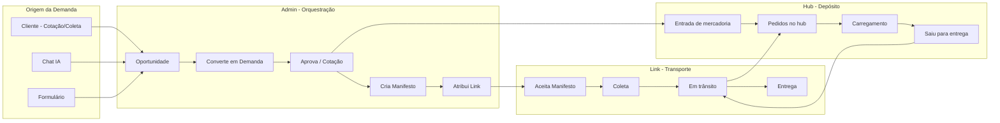
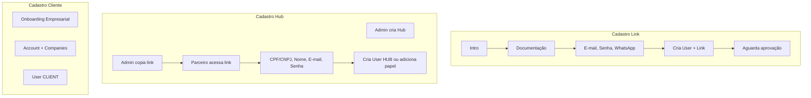
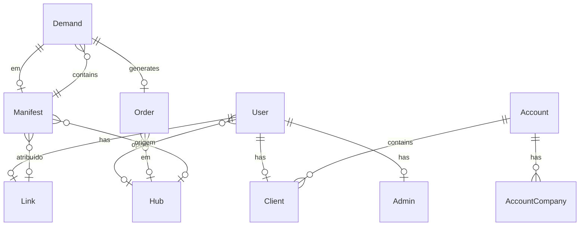
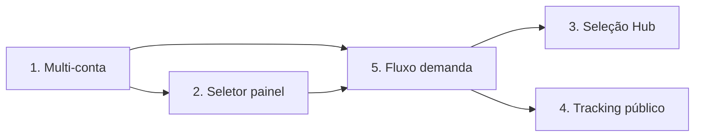

# Fluxograma do Sistema TSM EX

## 1. Visão geral dos atores e painéis

```mermaid
flowchart TB
    subgraph Atores [Atores do Sistema]
        Admin[Admin]
        Hub[Hub - Operador do Depósito]
        Link[Link - Motorista]
        Cliente[Cliente]
    end

    subgraph Painéis [Painéis / Rotas]
        Gestao[/gestao - Torre de Controle]
        LinkApp[/link - Minha Carga]
        Client[/client - Dashboard Cliente]
    end

    Admin --> Gestao
    Hub --> Gestao
    Link --> LinkApp
    Cliente --> Client
```

---

## 2. Fluxo de autenticação e rotas

```mermaid
flowchart TB
    Start([Acessa Sistema]) --> Login{Está autenticado?}
    Login -->|Não| LoginPage[Página de Login]
    Login -->|Sim| CheckRoles{Quais papéis?}

    LoginPage --> CadastroLink[Cadastro Link - /link/cadastro]
    LoginPage --> CadastroHub[Cadastro Hub - /hub/cadastro?hubId=xxx]
    LoginPage --> Onboarding[Conta Empresarial - /onboarding]

    CadastroLink --> Login
    CadastroHub --> Login
    LoginPage -->|Login OK| CheckRoles

    CheckRoles -->|CLIENT| Client[/client]
    CheckRoles -->|ADMIN ou HUB| Gestao[/gestao]
    CheckRoles -->|LINK| LinkApp[/link]

    Client --> DemandaClient[Demandas, Cotação, Coleta]
    Gestao --> DemandaAdmin[Demandas, Viagens, Pedidos, Hubs, Links]
    LinkApp --> ManifestoLink[Manifestos designados, Pedidos]
```

---

## 3. Ciclo operacional completo (demanda → entrega)



---

## 4. Cadastros e onboarding



---

## 5. Estrutura de dados (simplificada)



---

## 6. Próximos passos para o MVP

| # | Item | Prioridade | Descrição |
|---|------|------------|-----------|
| 1 | **Multi-conta por email** | Alta | Mesmo email pode ter Link, Hub, Admin, Cliente. Ao cadastrar novo papel, atribuir em vez de bloquear. |
| 2 | **Seletor de painel na UI** | Alta | Quando usuário tem múltiplos papéis, mostrar opção para trocar entre painéis (ex: "Ver como Admin", "Ver como Link"). |
| 3 | **Seleção de Hub no Link** | Média | Ao marcar "Chegou no hub", substituir prompt por dropdown de Hubs. |
| 4 | **Tracking público** | Média | Permitir link compartilhável de tracking sem login para o cliente acompanhar. |
| 5 | **Fluxo completo de demanda** | Alta | Validar ciclo: Cliente cria demanda → Admin aprova/cota → Cria manifesto → Atribui Link → Link confirma → Hub registra entrada/saída. |
| 6 | **Permissões HUB na UI** | Média | Interface para Admin definir permissões por usuário do Hub (entrada, manifestos, pedidos, demandas). |
| 7 | **Link app simplificado** | Média | Remover "Ofertas"; focar em manifesto designado, confirmação e documentação da viagem. |

---

## 7. Dependências entre itens



---

*Documento gerado em fev/2026 - TSM EX v2.0*
